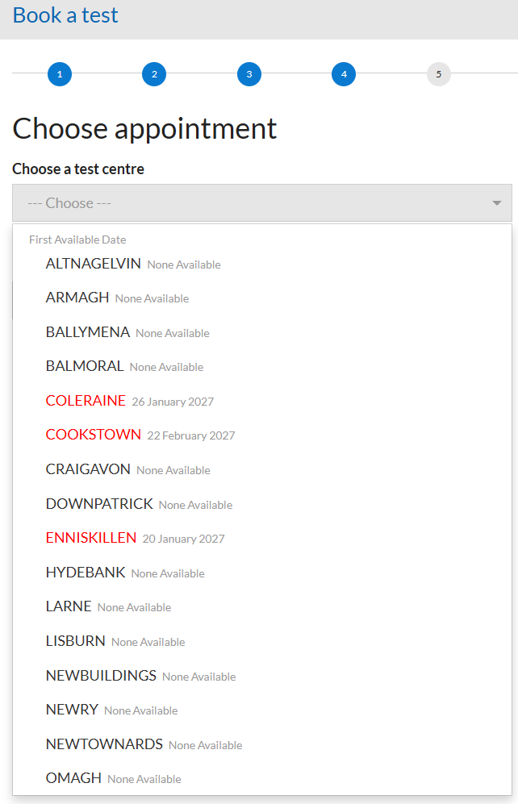
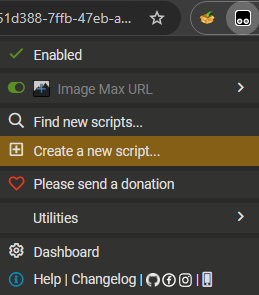
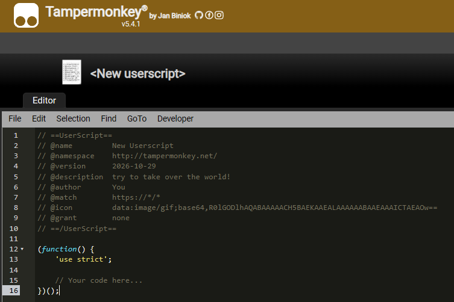
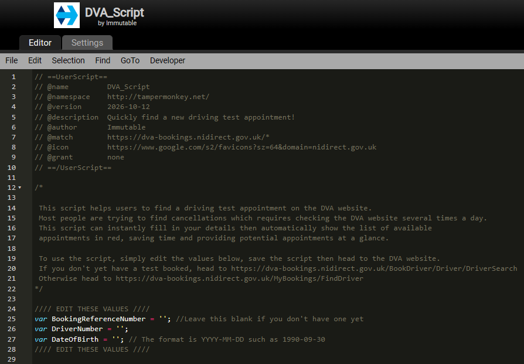

# Driving Test Finder

This script helps users to find a driving test appointment on the DVA website for Northern Ireland but can be adjusted for other booking sites. It currently only searches for Car or Category B tests.  
Most people are trying to find cancellations which requires checking the DVA website several times a day.  
This script can instantly fill in your details then automatically show the list of available
appointments in red, saving time and providing potential appointments at a glance.

  

## Installation

You will need to install a browser extension called TamperMonkey which allows javascript files to be executed on specific websites.  
After installing, click on the extension then click "Create a new script..."  

  

Replace the default userscript with the contents of DVA_Script.js and ensure you edit the values at the top of the script to include your details then click save. The values should be entered between the '' such as '1990-09-30'.

  
  

## Usage
Whenever you browse the DVA website the script will automatically fill in your details and navigate to different webpages.  
If you don't yet have a test booked, head to [this link](https://dva-bookings.nidirect.gov.uk/BookDriver/Driver/DriverSearch)  
Otherwise head to [this link](https://dva-bookings.nidirect.gov.uk/MyBookings/FindDriver)

I'd recommend saving the link as a bookmark and clicking it every time you wish to check for appointments.